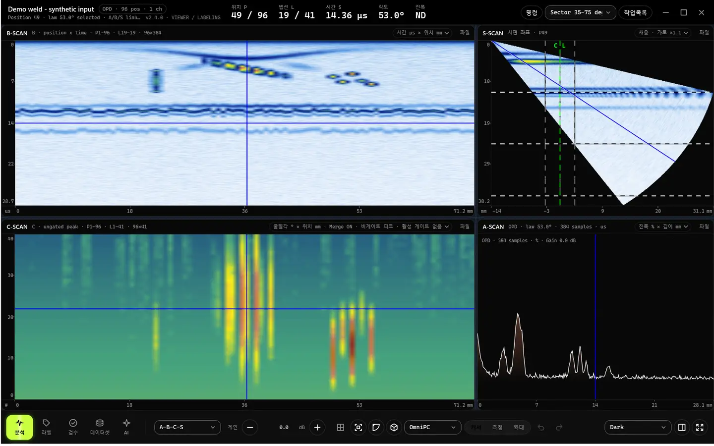

# PAUT AI

## 신호를 읽고 판단을 남기다.

Windows용 PAUT 검사 시각화·라벨링 작업 공간입니다. 연결된 스캔에서 신호를 살피고, 측정의 기준과 사람이 검토한 기록을 남깁니다.

[제품 소개](https://hyunjjun07.github.io/paut-ai-showcase/) · [기술 범위와 FAQ](TECHNICAL.md)



소개 화면의 기준은 **실제 앱 2.4.0**입니다. 공개 가능한 합성 데모 입력을 사용했으며, 현장 검사 결과·고객 데이터·실제 파일 parser 호환성이나 결함 성능의 증거가 아닙니다. 생성형 이미지로 앱 UI를 그리지 않았습니다.

## 실제 작업 흐름을 따라가는 시연

- [연결 스캔](https://hyunjjun07.github.io/paut-ai-showcase/?scene=scan#product-tour): 같은 취득 위치를 A/B/C/S로 봅니다.
- [라벨 검토](https://hyunjjun07.github.io/paut-ai-showcase/?scene=label#product-tour): 초안, 메모리 반영과 별도의 명시적 파일 저장을 구분합니다.
- [3D 표현](https://hyunjjun07.github.io/paut-ai-showcase/?scene=volume#product-tour): 물리·전개·native 인덱스 공간의 의미를 구분합니다.
- 측정: 기준 커서, 측정 모드, 커서 이동과 앱이 그린 실제 Δ를 살펴봅니다.
- 결함 묶음과 Direct/Leg 경로, 미관련 띠, 범위 검토, v9 안내와 학습 NPZ v3 내보내기를 실제 장면으로 봅니다.

슬라이더는 기록된 실제 프레임만 고릅니다. 판독값을 보간하거나 검사 데이터를 브라우저에서 새로 계산하지 않습니다. 화면 확대에서는 실제 캡처를 원본 크기로 이동해 읽을 수 있습니다. 앱 Light/Dark 쌍도 같은 데모의 실제 렌더링입니다.

자동재생은 일시정지할 수 있고 화면 밖·숨김 탭에서는 멈춥니다. 모션 감소 설정에서는 자동 영상 다운로드·재생과 pin·scrub을 사용하지 않고 장면을 직접 선택합니다. 키보드로 버튼·단계·슬라이더를 조작하고 확대를 Escape로 닫을 수 있습니다.

## 2.2부터 2.4까지의 작업 변화

- **메모리 반영과 저장.** 초안을 확인하고 라벨을 메모리에 반영한 뒤 별도로 파일을 저장합니다. 저장과 사람의 검토 결정은 같지 않습니다.
- **연결된 측정.** 기준/측정 커서와 차이 표시, S-scan 채움, 논리 Channel로 같은 취득 신호를 살펴봅니다.
- **검토 기록.** 결함 묶음·경로, 미관련 띠와 검토 범위를 구분합니다. 구조가 필요한 라벨은 v9 안내를 거치며 학습 NPZ v3에서도 미검토와 확인한 범위를 구분합니다.

## 데이터의 경계

NDE, UVDATA, CIVA 프로젝트, OPD, ODAT 입력 계열을 지원하지만 호환 범위는 포맷 버전과 취득 메타데이터에 따릅니다. Physical·S 적층·native P/L/S는 같은 XYZ가 아닙니다. 표시 Gain과 컬러맵은 원본 표본·측정값을 바꾸지 않습니다.

연구용 AI는 별도의 모델·실행 환경·사용 동의가 필요한 선택적 보조입니다. 후보는 확정 결함·합격/불합격 판정이 아니며 자동 승인·자동 라벨 저장을 뜻하지 않습니다.

## 공개 저장소와 로컬 미리보기

이 저장소에는 소개 페이지·실제 앱 시연 자산·공개 문서만 있습니다. **앱 소스는 비공개 독점 소프트웨어이며 설치 프로그램과 모델 패키지는 제공하지 않습니다.** 공개 소개 저장소가 앱의 오픈소스 배포나 사용권 부여를 뜻하지는 않습니다.

페이지는 HTML/CSS/JavaScript와 로컬 자산만 사용합니다. 외부 폰트 API·CDN·npm 설치 없이 index.html을 열 수 있습니다. 로컬 HTTP로 검사하려면 저장소 폴더에서 Python 표준 라이브러리 서버를 실행하세요.

```console
python -m http.server 8000 --bind 127.0.0.1
```

브라우저에서 localhost의8000포트로 확인하고 종료할 때 Ctrl+C를 누릅니다. 이 서버는 앱을 실행하거나 검사 파일을 분석하지 않습니다.

새 자산은 assets/demo-v240/에 있으며 기존2.1 시연 자산은 이력으로 보존합니다. 제목 폰트는 IBM Plex Sans KR에서 필요한 글리프만 추린 Field Notes Display이며 [OFL](assets/fonts/OFL.txt)을 동봉합니다.

## English summary

PAUT AI is a Windows desktop workspace for linked PAUT scan review and human-controlled labeling. The presentation uses actual app2.4.0 renders of public synthetic input. Memory edits, explicit file saving and review decisions remain distinct. Research AI is optional and does not make final inspection decisions. This repository contains presentation assets only, not proprietary app source, an installer or model packages.
